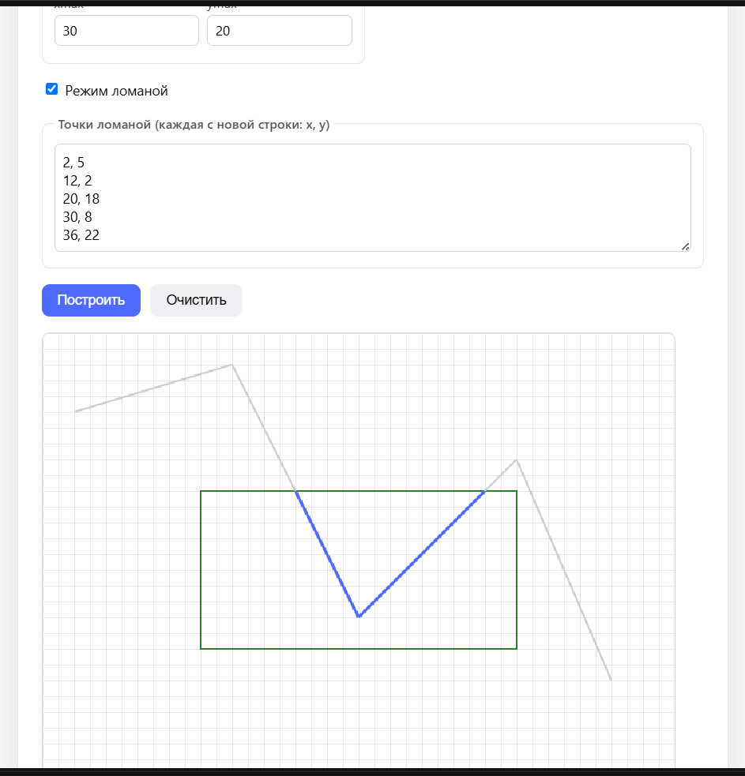

# Практическая работа №4. Отсечение отрезков алгоритмом Коэна–Сазерленда

## Как запустить программу
1. Откройте файл `index.html` в любом современном браузере (рекомендуется через расширение Live Server в VS Code).
2. Введите координаты окна отсечения (`xmin`, `ymin`, `xmax`, `ymax`).
3. Введите координаты одного отрезка. Если вы хотите проверить ломаную, поставьте галочку **«Режим ломаной»** — появится текстовое поле, куда можно вписать любое количество точек (каждая с новой строки в формате `x, y`).
4. Нажмите кнопку «Построить».

## Какое окно использовалось в тестах
По умолчанию в полях задано окно с границами:
- `xmin = 10`
- `ymin = 10`
- `xmax = 30`
- `ymax = 20`

Это окно хорошо подходит для наглядной проверки, так как оно находится в центре логической сетки (размером 40x30).

## Соглашение о четырёх битах кода
Каждая точка плоскости кодируется 4-битным числом, где каждый бит означает положение точки относительно границы окна:
- `INSIDE = 0` (0000) — точка внутри окна.
- `LEFT   = 1` (0001) — точка находится слева от окна (`x < xmin`).
- `RIGHT  = 2` (0010) — точка находится справа от окна (`x > xmax`).
- `BOTTOM = 4` (0100) — точка находится ниже окна (`y > ymax`). *(В Canvas ось Y направлена вниз)*.
- `TOP    = 8` (1000) — точка находится выше окна (`y < ymin`).

Комбинации битов формируются с помощью побитового ИЛИ (`|`). Например, точка в левом верхнем углу получит код `LEFT | TOP = 1001`.

## Результаты обязательных тестов
Программа успешно справляется со всеми требуемыми случаями:
1. **Полностью внутри:** Коды обеих точек 0000. Алгоритм мгновенно выполняет `ACCEPT`.
2. **Полностью слева:** Обе точки имеют бит `LEFT`. Алгоритм выполняет `REJECT` на первом шаге без вычисления пересечений.
3. **Пересекает одну границу:** Одна точка снаружи, другая внутри. Алгоритм вычисляет одну точку пересечения, заменяет внешний конец, и на следующем шаге выполняет `ACCEPT`.
4. **Пересекает две противоположные границы:** Точки находятся по разные стороны от окна. Алгоритм дважды находит пересечения (с левой/правой границей), после чего выполняет `ACCEPT`.
5. **Проходит через угол:** Алгоритм аккуратно отсекает внешние части по обеим осям.
6. **Вертикальный и горизонтальный:** Работают корректно благодаря быстрой проверке кодов (деление на ноль не происходит, если отрезок снаружи).
7. **Обе точки снаружи, но отрезок проходит через окно:** Алгоритм отсекает одну границу, затем вторую, после чего оставляет видимую часть внутри.
8. **Ломаная (режим из 5+ точек):** Каждый сегмент обрабатывается отдельно. Коды выводятся для каждой пары точек, а таблица итераций визуально разделена на блоки («Сегмент 1», «Сегмент 2» и т.д.).

## Результаты эксперимента со случайными отрезками
При нажатии кнопки «Запустить» программа генерирует 100 случайных отрезков и классифицирует их. 
Эксперимент показывает эффективность алгоритма Коэна–Сазерленда: большинство отрезков, находящихся полностью снаружи (в одной полуплоскости) или полностью внутри, обрабатываются **мгновенно** только за счёт побитовых операций (`|` и `&`), без вычисления точек пересечения.

## Скриншот
