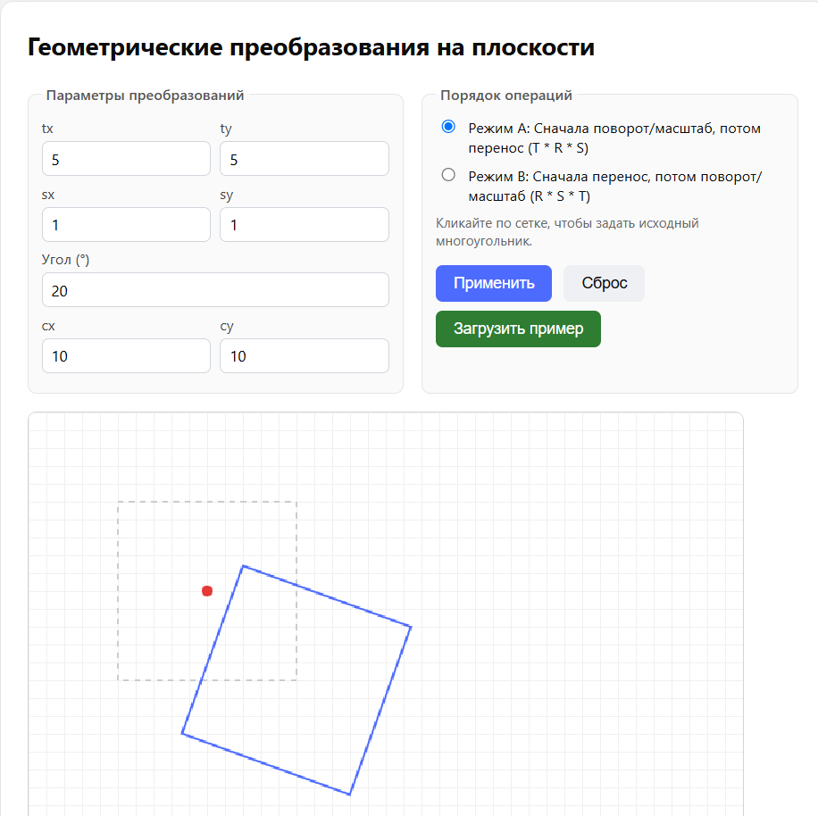

# Практическая работа №7. Редактор геометрических преобразований

## 1. Порядок запуска
1. Откройте файл `index.html` в любом современном браузере (рекомендуется использовать расширение Live Server в VS Code).
2. Чтобы быстро начать, нажмите кнопку **«Загрузить пример»** — появится тестовый квадрат. Либо кликайте левой кнопкой мыши по сетке, чтобы нарисовать свой многоугольник.
3. Введите параметры преобразования (сдвиг, масштаб, угол, координаты центра).
4. Выберите порядок операций (Режим А или Режим Б) и нажмите **«Применить»**.
5. Кнопка **«Сброс»** полностью очищает холст, чтобы можно было нарисовать новую фигуру.

## 2. Определения матриц T, R, S
Мы используем однородные координаты (вектор-столбец `[x, y, 1]^T`) и матрицы 3x3.

- **Матрица переноса (T):**
  `[ [1, 0, tx], [0, 1, ty], [0, 0, 1] ]`
- **Матрица масштабирования (S):**
  `[ [sx, 0, 0], [0, sy, 0], [0, 0, 1] ]`
- **Матрица поворота (R):**
  `[ [cosθ, -sinθ, 0], [sinθ, cosθ, 0], [0, 0, 1] ]`

## 3. Умножение матриц
Для перемножения двух матриц `A` и `B` (размером 3x3) используется классическое правило «строка на столбец»:
`C[i][j] = A[i][0]*B[0][j] + A[i][1]*B[1][j] + A[i][2]*B[2][j]`.
Поскольку матрицы некоммутативны, порядок умножения `A * B` имеет решающее значение (сначала применяется матрица, стоящая справа).

## 4. Центр преобразования
По умолчанию в качестве центра используется точка `(cx, cy) = (10, 10)`, которую можно менять в полях ввода. Она обозначается красной точкой на холсте. 
Чтобы повернуть или отмасштабировать фигуру вокруг этой точки (а не вокруг начала координат `(0,0)`), мы выполняем композицию:
`M_вокруг_центра = T(cx, cy) * R(θ) * S(sx, sy) * T(-cx, -cy)`.

## 5. Таблица ручного расчёта (Пример)
Возьмем точку `P(2, 1)`. Применим поворот на 90° и перенос на `(3, 0)`.
Сначала поворот:
- `x' = 2 * cos(90) - 1 * sin(90) = -1`
- `y' = 2 * sin(90) + 1 * cos(90) = 2`
Точка после поворота: `(-1, 2)`.
Затем перенос `tx=3`:
- `x'' = -1 + 3 = 2`
- `y'' = 2 + 0 = 2`
**Итог: `(2, 2)`**.

## 6. Результаты разных порядков операций
Проверим на примере точки `P(2, 1)`, `tx=3`, `угол=90°`:
1. **Режим A (Сначала R, потом T):** `(2, 1)` → поворот → `(-1, 2)` → перенос → **`(2, 2)`**.
2. **Режим B (Сначала T, потом R):** `(2, 1)` → перенос → `(5, 1)` → поворот → **`(-1, 5)`**.

## 7. Почему результаты отличаются
Матричное умножение некоммутативно (`T * R ≠ R * T`). В геометрии это означает, что поворот вокруг начала координат, а затем сдвиг — это не то же самое, что сдвиг, а затем поворот вокруг начала координат. Из-за сдвига точка меняет расстояние от начала координат, поэтому при последующем повороте она описывает другую окружность.

## 8. Скриншот

