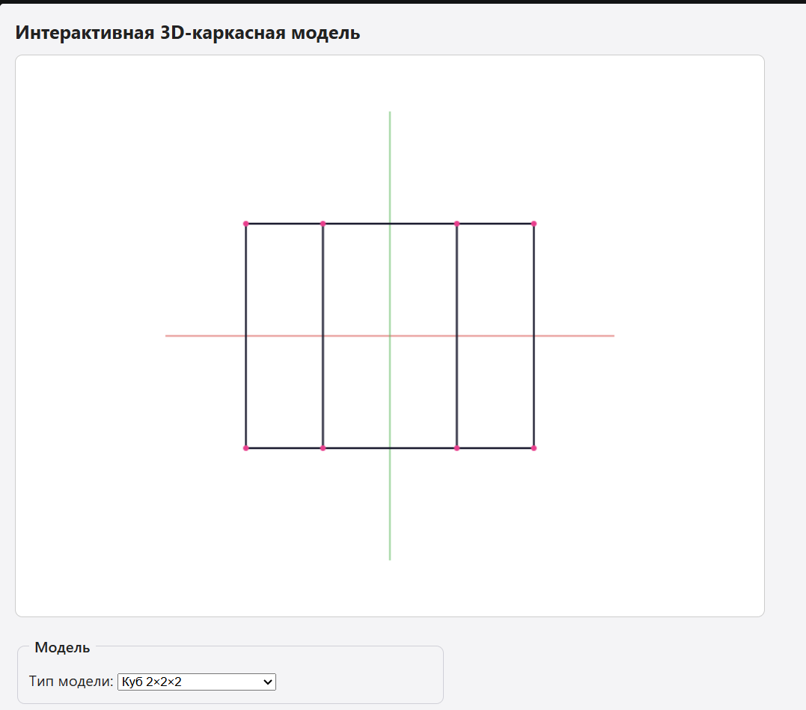
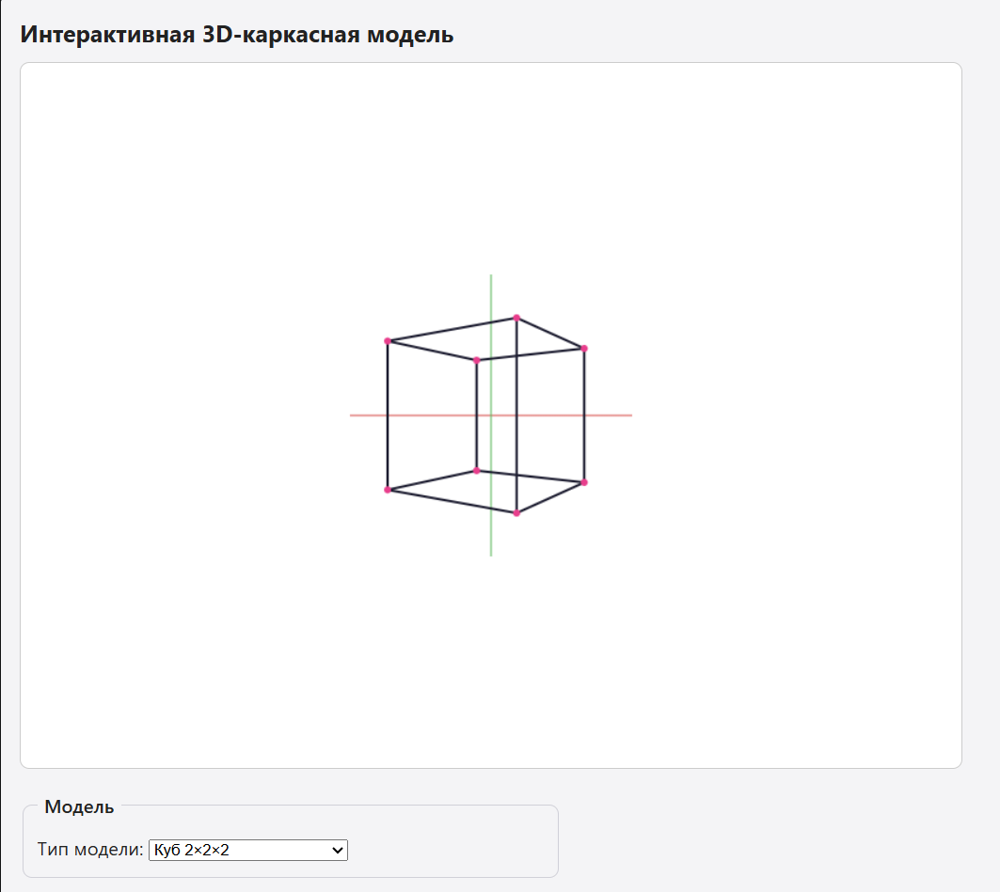

# Практическая работа №8. Интерактивная 3D-каркасная модель

## 1. Система координат и камера

Используется **правая** математическая система координат и **векторы-столбцы**:
точка — это столбец `(x, y, z, 1)ᵀ`, преобразование — умножение матрицы слева: `P' = M·P`.

Соглашение о камере (учебное, фиксированное):

- наблюдатель находится в начале координат;
- камера смотрит вдоль **положительной** оси Z;
- X направлена вправо, Y — вверх;
- видимыми считаются точки с `z > 0` (на практике — с `z ≥ near = 0.1`).

Модель задана вокруг начала координат и перед отрисовкой сдвигается вперёд на
`tz` (ползунок «Расстояние»), поэтому все вершины оказываются перед камерой.

На Canvas ось Y направлена **вниз**, поэтому при проекции берётся `−y`.

## 2. Исходные вершины и рёбра

### Куб 2×2×2 (модель по умолчанию)

```
Вершины                              Рёбра
0: (-1, -1, -1)   4: (-1, -1,  1)    [0,1] [1,2] [2,3] [3,0]   — задняя грань
1: ( 1, -1, -1)   5: ( 1, -1,  1)    [4,5] [5,6] [6,7] [7,4]   — передняя грань
2: ( 1,  1, -1)   6: ( 1,  1,  1)    [0,4] [1,5] [2,6] [3,7]   — соединяющие
3: (-1,  1, -1)   7: (-1,  1,  1)
```

### Параллелепипед 3×1×2

```
Вершины                                        Рёбра
0: (-1.5, -0.5, -1)   4: (-1.5, -0.5,  1)      те же 12 рёбер:
1: ( 1.5, -0.5, -1)   5: ( 1.5, -0.5,  1)      [0,1][1,2][2,3][3,0]
2: ( 1.5,  0.5, -1)   6: ( 1.5,  0.5,  1)      [4,5][5,6][6,7][7,4]
3: (-1.5,  0.5, -1)   7: (-1.5,  0.5,  1)      [0,4][1,5][2,6][3,7]
```

### Пирамида

```
Вершины                              Рёбра
0: (-1, -0.5, -1)   — основание      [0,1][1,2][2,3][3,0] — квадрат основания
1: ( 1, -0.5, -1)                   [0,4][1,4][2,4][3,4] — боковые рёбра к вершине
2: ( 1, -0.5,  1)
3: (-1, -0.5,  1)
4: ( 0,  1,    0)   — вершина
```

Геометрия (вершины + рёбра) отделена от преобразований и отрисовки.
Исходный массив вершин при перерисовке не изменяется: каждый кадр пересчитывается
из оригинальных вершин и текущих параметров (нет накопления погрешностей).

## 3. Матрицы поворотов (угол θ, c = cos θ, s = sin θ)

```
Rx = | 1  0  0 0 |    Ry = |  c 0  s 0 |    Rz = | c -s 0 0 |
     | 0  c -s 0 |         |  0 1  0 0 |         | s  c 0 0 |
     | 0  s  c 0 |         | -s 0  c 0 |         | 0  0 1 0 |
     | 0  0  0 1 |         |  0 0  0 1 |         | 0  0 0 1 |
```

Перенос: `T(tx,ty,tz)` — tx, ty, tz в последнем столбце. Масштаб: `S(sx,sy,sz)` —
по главной диагонали. Для аффинных преобразований нижняя строка `(0,0,0,1)`, `w = 1`.

## 4. Порядок преобразований

Для векторов-столбцов правая матрица применяется первой:

```
P_world = T(0, 0, tz) · Rz · Ry · Rx · S · P_local
```

Сначала модель масштабируется, затем поворачивается вокруг X, Y, Z
(вокруг собственного центра, так как вершины заданы вокруг нуля),
в конце переносится на расстояние `tz` перед камерой.

## 5. Формулы проекций

**Ортографическая** (глубина игнорируется, `scale` — пикселей на единицу мира):

```
screenX = width/2  + scale · x
screenY = height/2 − scale · y       
```

**Перспективная** (`f` — фокусное расстояние в пикселях):

```
screenX = width/2  + f · x / z
screenY = height/2 − f · y / z        
```

При уменьшении `f` и при увеличении `z` (расстояния до камеры) изображение уменьшается.

## 6. Ручной расчёт одной точки

Вершина 0 куба: `P_local = (−1, −1, −1)`. Параметры: без поворотов, `S = 1`, `tz = 5`,
канвас 800×600, ортографический `scale = 120`, перспективный `f = 300`.

Матрица модели (без поворотов и масштаба — только перенос):

```
M = T(0,0,5) = | 1 0 0 0 |
               | 0 1 0 0 |
               | 0 0 1 5 |
               | 0 0 0 1 |
```

Точка после матрицы модели: `x = −1, y = −1, z = −1 + 5 = 4`, то есть `(−1, −1, 4)`,
`z = 4 > 0.1` — точка видима.

Ортографическая проекция:

```
screenX = 400 + 120·(−1) = 280
screenY = 300 − 120·(−1) = 420
```

Перспективная проекция:

```
screenX = 400 + 300·(−1)/4 = 400 − 75 = 325
screenY = 300 − 300·(−1)/4 = 300 + 75 = 375
```

Совпадает с показаниями панели «Выбранная вершина» при этих параметрах.

## 7. Отсечение ближней плоскостью

Введена ближняя плоскость `near = 0.1`. Ребро `A → B` параметризуется как
`P(t) = A + t·(B − A)`; точка пересечения с плоскостью:

```
t = (near − A.z) / (B.z − A.z)
```

Возможные случаи:

- обе точки имеют `z < near` — ребро не рисуется;
- обе точки имеют `z ≥ near` — рисуется целиком;
- одна точка за плоскостью — заменяется точкой пересечения `cut`, рисуется
  только видимая часть.

Без отсечения точка с `z ≈ 0⁺` дала бы `f·x/z → ∞`, и линия «улетала» бы на огромные
координаты. Проверки `z > 0` для отдельной точки недостаточно — ребро пересекает
плоскость в промежуточной точке, поэтому отсекается именно оно. Отсечение применяется
и к ортографической проекции, чтобы не показывать части объекта за камерой.

## 8. Результаты обязательных испытаний

| № | Испытание | Результат |
|---|-----------|-----------|
| 1 | Нулевые углы, масштаб 1, статический куб | Каркас куба 2×2×2 корректен, рёбра параллельны осям |
| 2 | Поворот вокруг каждой оси отдельно | Форма деформируется в соответствии с матрицами Rx, Ry, Rz |
| 3 | Поворот на 360° | Ориентация возвращается к исходной (погрешность ~1e-16, cos(2π) = 1) |
| 4 | Две точки разной глубины | При ортографии вершины 4 и 6 симметричны; при перспективе дальняя (4) ближе к центру экрана |
| 5 | Увеличение tz | Перспективное изображение уменьшается; ортографическое не меняется |
| 6 | Приближение куба к near (tz ≈ 1.5 + масштаб) | Рёбра корректно обрезаются, NaN и «улетевших» линий нет |
| 7 | Пауза | Углы перестают изменяться, кадр статичен |
| 8 | Сброс | Все параметры возвращаются к значениям по умолчанию |


## 9. Скриншоты

**Ортографическая проекция куба:**



**Перспективная проекция куба:**




