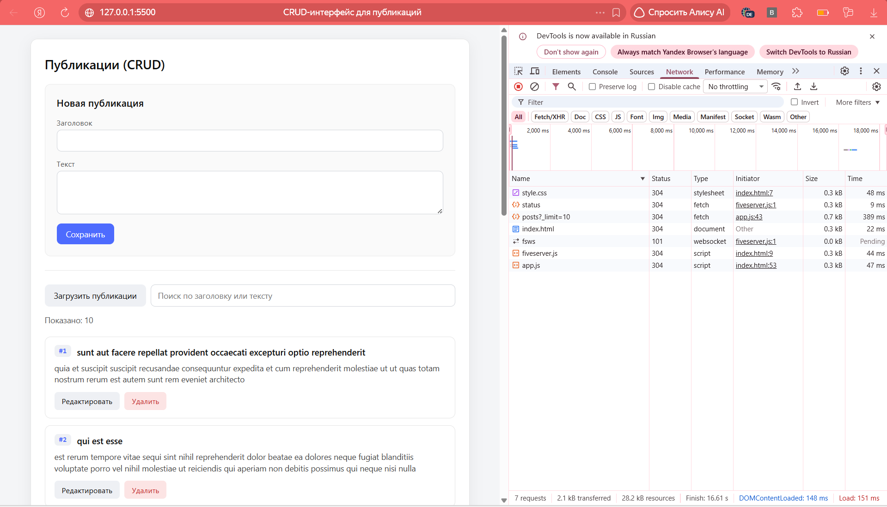
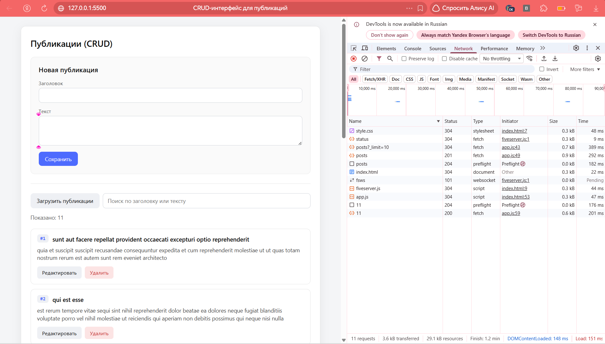
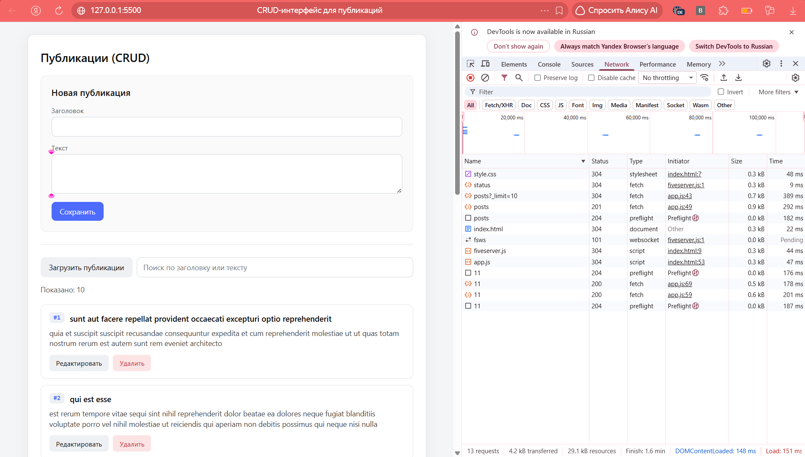

# Занятие 4. CRUD-интерфейс для публикаций

Приложение для работы с публикациями через публичный API JSONPlaceholder.
Реализованы создание, чтение, редактирование и удаление (CRUD).

## Как запустить

1. Открыть `index.html` в браузере (лучше через Live Server).
2. Нажать «Загрузить публикации», чтобы получить данные с сервера.
3. Использовать форму для создания новых записей.
4. Нажимать «Редактировать» или «Удалить» на карточках для работы с ними.

## Используемый API

`https://jsonplaceholder.typicode.com/posts` — тестовый API, который
имитирует сервер. Важно: он **не сохраняет данные** между запросами.

## Реализованные HTTP-методы

- `GET /posts?_limit=10` — загрузка списка публикаций.
- `POST /posts` — создание новой публикации.
- `PATCH /posts/:id` — редактирование существующей.
- `DELETE /posts/:id` — удаление публикации.

## Как устроено состояние

Состояние хранится в объекте `state` в `app.js`:

- `state.posts` — массив загруженных публикаций;
- `state.isLoading` — флаг загрузки;
- `state.isSaving` — флаг сохранения (блокирует кнопки);
- `state.error` — текст ошибки;
- `state.filter` — строка поиска;
- `state.editingId` — id редактируемой записи (`null` = режим создания).

## Как обрабатываются ошибки

Каждый запрос обёрнут в `try/catch`. Если `response.ok` ложно,
выбрасывается исключение, которое перехватывается и записывается
в `state.error`. В `finally` снимается флаг загрузки/сохранения
и вызывается `render()`.

## Что происходит после успешных запросов

- **POST:** полученный объект добавляется в начало `state.posts`.
- **PATCH:** объект в массиве заменяется обновлёнными данными.
- **DELETE:** элемент удаляется из массива через `filter()`.

Только после успешного ответа сервера интерфейс обновляется.
Если запрос упал — данные в `state.posts` остаются прежними.

## Почему изменения исчезают после перезагрузки

JSONPlaceholder — это **имитация** REST API. Он принимает запросы,
возвращает правдоподобные ответы (например, объект с новым id),
но физически не сохраняет данные. Поэтому при перезагрузке страницы
GET-запрос возвращает исходные 10 публикаций.

Чтобы изменения сохранялись, нужен настоящий бэкенд с базой данных.

## Скриншоты Network

**GET-запрос (загрузка):**

**POST-запрос (создание):**

**PATCH-запрос (редактирование):**

**DELETE-запрос (удаление):**

