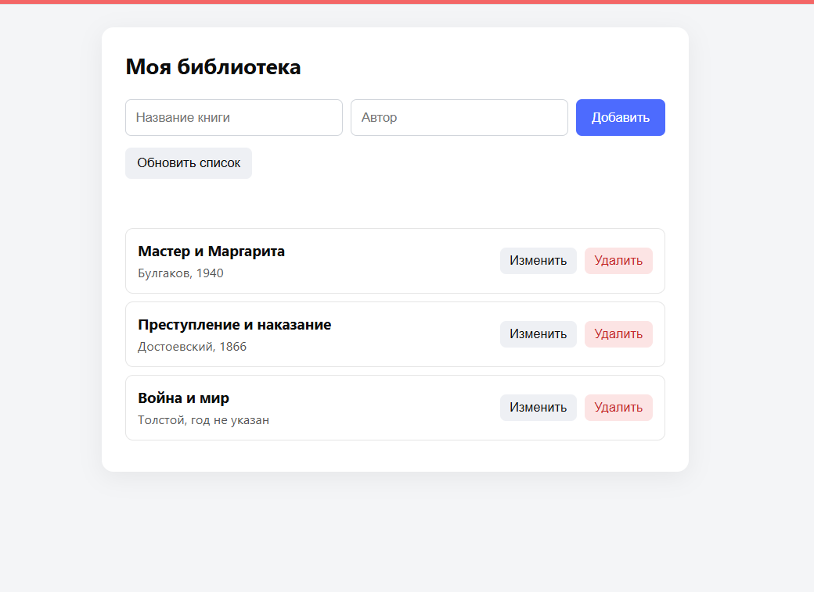
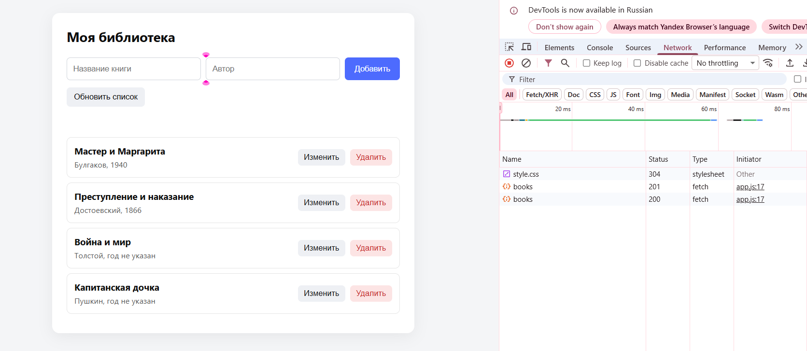
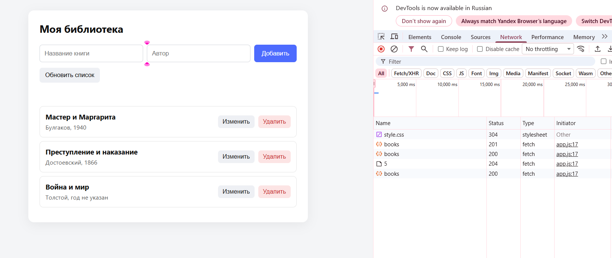

# Практическая работа №7. Клиент и собственный API (fetch + Express + SQLite)

## 1. Команды установки и запуска
1. Установите зависимости: `npm install`
2. Запустите сервер: `npm start`
3. Откройте в браузере: `http://localhost:3000`

## 2. Структура проекта
- `server.js` — Express-сервер (раздает статику и обрабатывает API).
- `public/index.html` — интерфейс пользователя.
- `public/style.css` — стили.
- `public/app.js` — клиентская логика (fetch, DOM, состояние).
- `data.db` — база данных SQLite (создается автоматически и не коммитится).

## 3. Схема обмена данными
Пользователь заполняет форму → JS (fetch) отправляет HTTP-запрос → Express-сервер принимает запрос → SQL-запрос к SQLite → база возвращает данные → сервер отдает JSON → JS обновляет интерфейс через `render()`.

## 4. Список используемых API-маршрутов
- `GET /api/books` — получить список всех книг.
- `GET /api/books/:id` — получить одну книгу.
- `POST /api/books` — создать новую книгу.
- `PATCH /api/books/:id` — изменить данные книги.
- `DELETE /api/books/:id` — удалить книгу.

## 5. Действия пользователя в интерфейсе
1. Просмотр списка книг при загрузке страницы.
2. Добавление книги через форму (с валидацией на клиенте и сервере).
3. Нажатие «Изменить» заполняет форму, и сохранение отправляет PATCH-запрос.
4. Нажатие «Удалить» запрашивает подтверждение и отправляет DELETE-запрос.
5. Нажатие «Обновить список» принудительно делает GET-запрос.

## 6. Скриншоты работы
### 6.1. Общий вид приложения
На скриншоте виден интерфейс со списком книг, формой добавления и кнопками управления.

### 6.2. POST-запрос (Создание книги)
На скриншоте вкладки Network видно, что при добавлении книги отправляется метод `POST` на `/api/books`, сервер отвечает статусом `201 Created`, а в Payload передается JSON с названием и автором.

### 6.3. DELETE-запрос (Удаление книги)
На скриншоте вкладки Network видно, что при удалении книги отправляется метод `DELETE` на `/api/books/1`, сервер отвечает статусом `204 No Content` (успешно, без тела ответа).

## 7. Проверка ошибок 400/404
- **400 Bad Request:** Если обойти клиентскую валидацию и отправить POST без обязательного поля (например, без автора), сервер вернет 400. Клиент перехватит ошибку и покажет ее пользователю.
- **404 Not Found:** При попытке удалить или изменить запись, которой нет в базе (например, через консоль браузера), сервер вернет 404, а интерфейс покажет сообщение об ошибке.

## 8. Проверка сохранения данных после перезапуска
1. Добавьте новую книгу через интерфейс.
2. Остановите сервер (`Ctrl + C` в терминале).
3. Запустите сервер снова (`npm start`).
4. Обновите страницу (F5). Книга останется в списке, так как данные хранятся в базе `data.db`.

## 9. Безопасный вывод (textContent)
При отображении названий и авторов используется `textContent` и `document.createElement()`, а не `innerHTML`. 
Если ввести название `<b>Проверка</b>`, на странице отобразится текст с угловыми скобками. Это защищает приложение от XSS-атак (внедрения вредоносного HTML/JS-кода).