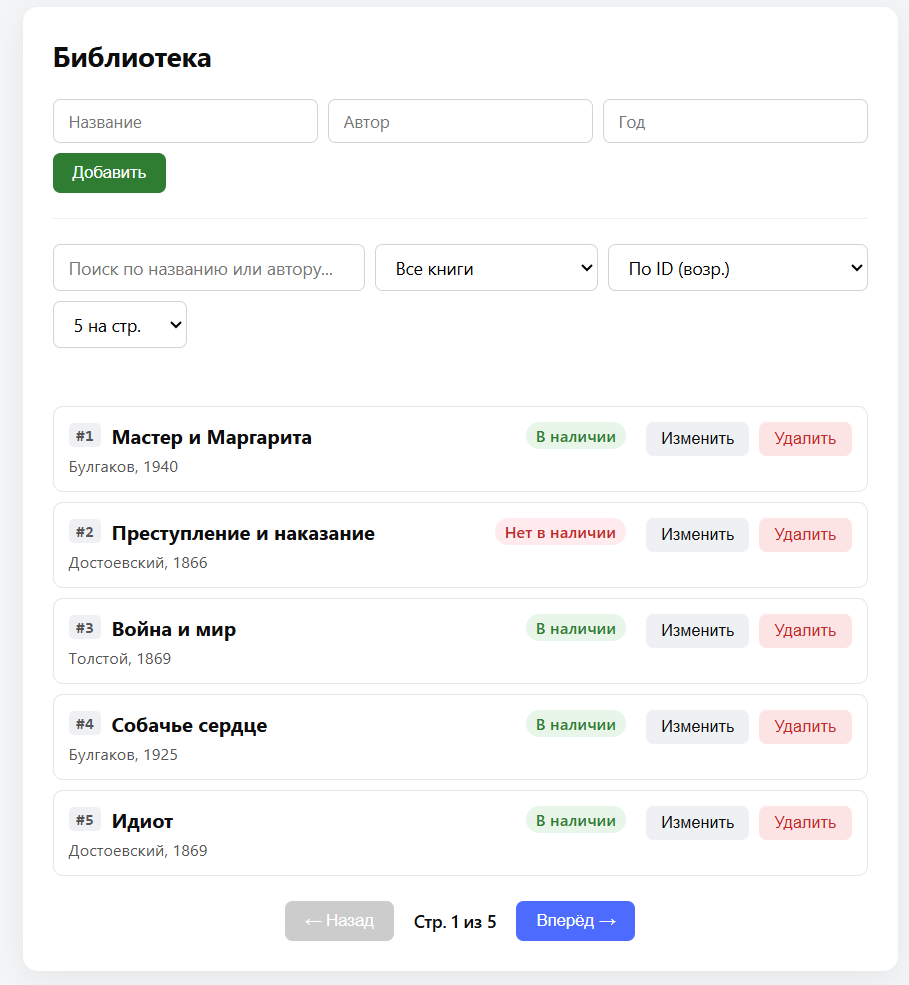
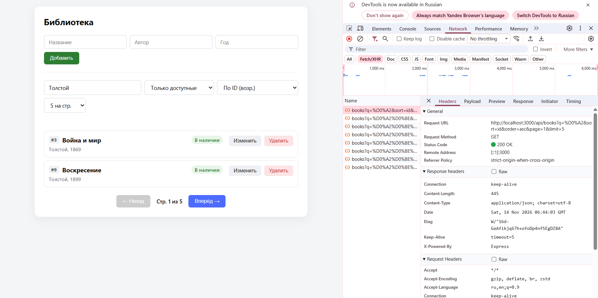
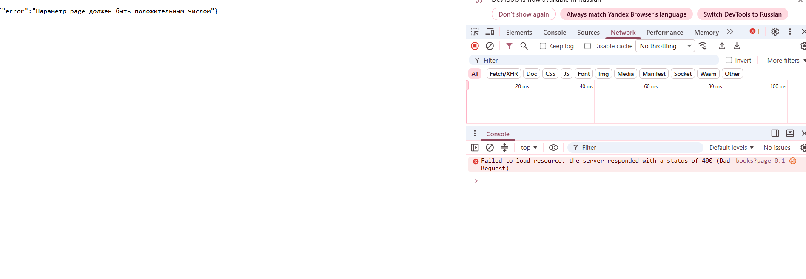
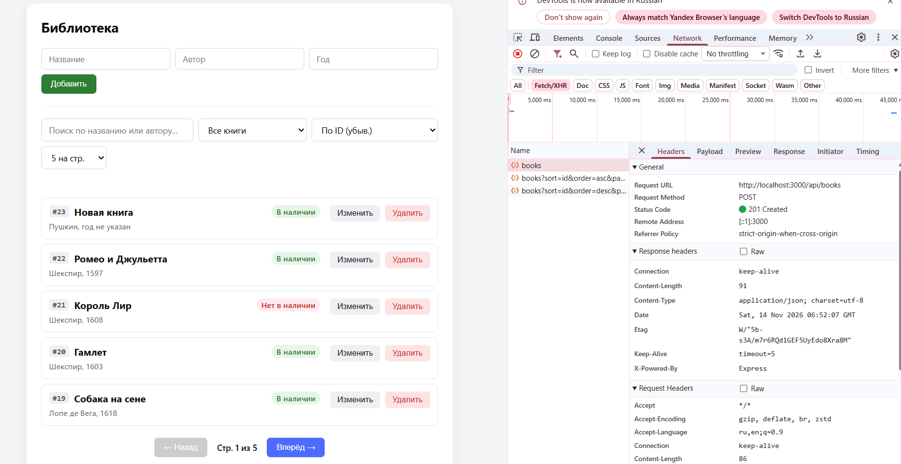

# Практическая работа №8. Каталог с серверным поиском и пагинацией

## 1. Запуск и структура проекта
**Порядок запуска:**
1. Откройте терминал в папке `internet-technologies/08`.
2. Установите зависимости: `npm install`
3. Заполните базу демонстрационными данными (22 книги): `npm run seed`
4. Запустите сервер: `npm start`
5. Откройте в браузере: `http://localhost:3000`

**Структура:**
- `server.js` — Express-сервер, реализующий REST API, SQL-фильтрацию и пагинацию.
- `seed.js` — скрипт для первичного заполнения базы данных.
- `public/` — папка с клиентской частью (index.html, style.css, app.js).
- `data.db` — файл базы данных SQLite (создается автоматически, в Git не загружается).

## 2. Таблица параметров API (GET /api/books)
Все параметры передаются в URL как query-параметры.

| Параметр | Допустимые значения | По умолчанию | Описание |
| :--- | :--- | :--- | :--- |
| `q` | Любая строка | нет | Поиск по названию (title) или автору (author) |
| `available` | `true` или `false` | нет | Фильтр по наличию книги |
| `sort` | `id`, `title`, `author`, `year` | `id` | Поле для сортировки |
| `order` | `asc` или `desc` | `asc` | Направление сортировки |
| `page` | Положительное целое число | `1` | Номер запрашиваемой страницы |
| `limit` | Целое число от 1 до 50 | `5` | Количество записей на странице |

## 3. Пример JSON-ответа с пагинацией
Сервер возвращает объект, в котором массив `items` содержит только записи для текущей страницы, а объект `meta` — метаданные пагинации.

Пример ответа:
- `items`: массив объектов (id, title, author, year, available).
- `meta`: объект, содержащий:
  - `page`: 1
  - `limit`: 5
  - `total`: 22 (общее количество найденных записей)
  - `pages`: 5 (общее количество страниц)

## 4. SQL-примеры запросов
Фильтрация (WHERE), сортировка (ORDER BY) и пагинация (LIMIT/OFFSET) выполняются на стороне базы данных.

**Поиск и фильтрация:**
Запрос: `SELECT * FROM books WHERE 1=1 AND (title LIKE ? OR author LIKE ?) AND available = ?`
Параметры: `%Толстой%`, `%Толстой%`, `1`.

**Сортировка и пагинация:**
Запрос: `SELECT * FROM books ORDER BY title ASC LIMIT ? OFFSET ?`
Параметры: `5`, `0` (для первой страницы при limit=5).

## 5. Защита от SQL-инъекций
Безопасность обеспечивается двумя способами:
1. **Параметризованные запросы (плейсхолдеры `?`):** Значения поиска (`q`) и фильтров (`available`) передаются отдельно от SQL-запроса, что делает внедрение SQL-кода через эти поля невозможным.
2. **Белый список (whitelist) для сортировки:** Пользовательский ввод из параметров `sort` и `order` нельзя напрямую подставлять в `ORDER BY`, так как имена столбцов нельзя параметризовать через `?`. Поэтому реализован массив `allowedSortFields` (id, title, author, year). Если пользователь передаст `?sort=id;DROP TABLE books`, сервер проверит поле по белому списку и вернет ошибку 400. В SQL подставляются только жестко заданные строки.

## 6. Скриншоты интерфейса и Network
*(Инструкция: замените пути на свои картинки)*
1. **Интерфейс каталога:** виден список книг, пагинация и панель фильтров.
   
2. **Сетевой запрос с фильтром и поиском:** GET-запрос со статусом 200.
   
3. **Ошибка 400:** GET-запрос `?page=0` возвращает статус 400 Bad Request (защита от инъекции).
   
4. **Успешный POST (из формы):** Статус 201 Created.
   

## 7. Результаты проверок
- **Пагинация:** Записи на 1 и 2 страницах различаются (благодаря `LIMIT` и `OFFSET`).
- **Метаданные `total`:** Равен общему числу подходящих записей (например, 22), а не размеру страницы (5).
- **Совместная работа:** Поиск по слову "Толстой" + фильтр "в наличии" возвращает только нужные записи.
- **Сортировка:** Работает по ID (возр/убыв) и году (сначала новые/старые).
- **Пустой результат:** При вводе несуществующего названия выводится сообщение "Ничего не найдено".
- **Ошибка 400:** Возвращается при запросе `?sort=wrong_field` или `?page=-5`.
- **Удаление:** Если удалить последнюю запись на странице, интерфейс автоматически запрашивает предыдущую страницу, предотвращая пустоту.
- **Сохранность данных:** После перезапуска Node.js записи остаются на месте (SQLite).

## 8. Отличие серверной фильтрации от array.filter() в браузере
**Серверная фильтрация (в этой работе):**
Браузер отправляет параметры (поиск, страницу) на сервер. Сервер выполняет SQL-запрос с `WHERE`, `LIMIT` и `OFFSET` и возвращает только 5-10 нужных записей. Это позволяет работать с базами на миллионы строк, не нагружая память пользователя.

**Фильтрация в браузере (array.filter):**
Сначала нужно загрузить абсолютно все записи с сервера (GET-запрос без ограничений). Затем браузер перебирает весь огромный массив в оперативной памяти, фильтрует его и показывает кусочек. На больших данных это приведет к зависанию вкладки и огромному расходу трафика. Задание требует именно серверный подход.